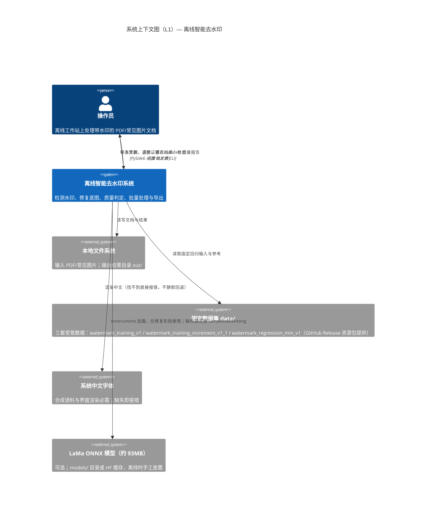
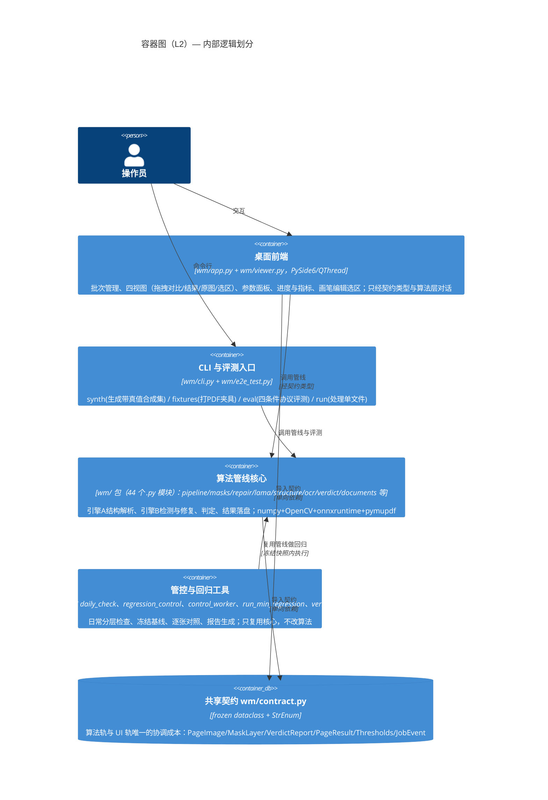
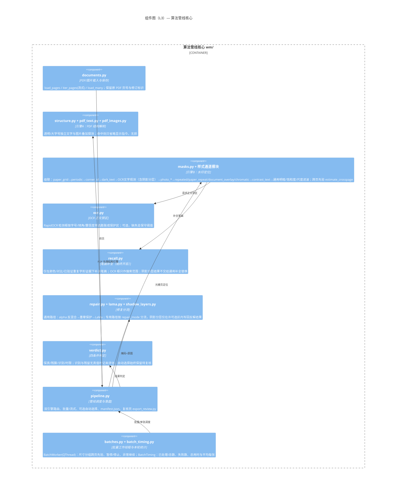
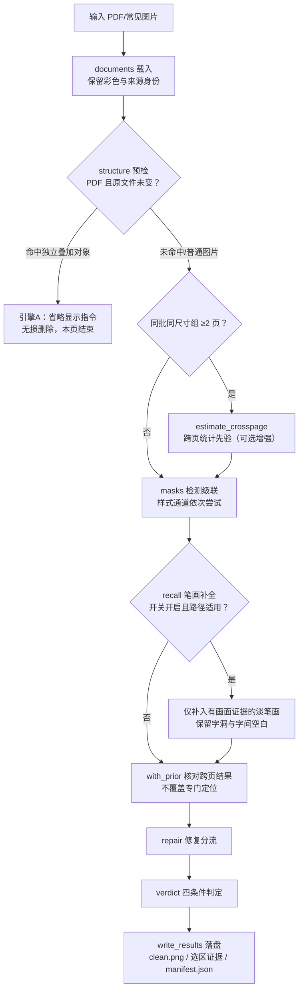

# 项目认知文档（knowme）

> 版本：V1.4（2026-11-02）
> 依据：对截至 2026-10-30 最新提交源码的完整走读（`wm/` 44 个模块、约 9.4k 行，`tools/` 97 个脚本，`tests/` 40 个测试文件）
> 读者：刚拿到代码的新手。读完本文应能回答四个问题：**项目架构是什么样、用了什么技术、核心逻辑怎么跑、如何编译运行**。
> 关系：本文是项目认知文档的唯一当前入口；2026-10-26 的根目录初版 C4 说明已作为重复历史副本删除。
> 配套权威文档：处理流程细节以 [去水印处理流程图.md](去水印处理流程图.md) 为准；运行口径以 [README.md](../README.md) 与 [MIGRATION.md](../MIGRATION.md) 为准。

---

## 0. 三分钟速览

**这是一个离线桌面工具**：在本地工作站上对带水印的 PDF / 常见图片（PNG、JPG、BMP、TIFF）文档做水印检测与去除，支持单张与多批次处理，全程不联网（模型首次准备除外）。

- **物理基础**：叠印模型 `I = s·B + t`（`s=1-α₀`，`t=α₀W`）。能用代数反混合还原的底色优先反解；水印压住文字的"不透明核心"交给本地 LaMa 深度学习补图。
- **双引擎**：PDF 先看能不能**无损**删掉独立水印对象（引擎A，结构解析）；不行的页再走像素检测+修复（引擎B，光栅分析）。
- **质量口径**：自研"四条件判定协议"（保真/残膜/识别/时限），逐页出 `manifest.json`；没有干净参考的页一律标"待复核"，不计入成功率。
- **工程特色**：整套"防退化管控"（冻结代码快照 → 固定集全量运行 → 逐张对照基线 → 显式放行），日常 `./start.sh test`、发布 `./start.sh test-release`。

新手第一条命令：`./start.sh setup`，然后 `./start.sh gui` 打开桌面程序。

---

## 1. C4 架构视图

### 1.1 Level 1 — 系统上下文（System Context）

系统只服务一个角色——**操作员**；不与任何外部服务通信（LaMa 模型下载属于部署动作，不是运行时依赖）。



### 1.2 Level 2 — 容器图（Container）

单体 Python 应用，无网络服务。五个逻辑容器：**桌面前端、CLI/评测入口、算法管线核心、管控工具链、共享契约**。



### 1.3 Level 3 — 组件图（Component）

算法核心内部：一次处理 = **结构预检 → 检测级联 → （可选）笔画补全 → 修复分流 → 判定 → 落盘**。默认关闭的自动选择候选会在检测后另走原图预选、按需补试与导出流程，见 §3.8。



### 1.4 Level 4 — 代码层（核心契约类型）

算法轨与 UI 轨只通过 `wm/contract.py` 的类型通信，改字段是唯一协调成本：

| 类型 | 职责 |
|---|---|
| `Thresholds`（frozen） | 全部可调参数：检测灵敏度、保真/残膜/识别/时限门槛、LaMa 瓦片参数、三个默认关闭的实验开关；自动选择开关由桌面/CLI 单独传入 |
| `PageImage` | 一页图 + dpi + 来源身份（doc_id、原文件页号、修订标识，防止多 PDF 合批错页） |
| `MaskLayer` | 逐像素水印覆盖率 `alpha [0,1]` + 来源档位 + 实测 `veil_strength/veil_offset`（物理模型参数）+ 实例列表 + 手工选区 `selection` + 阴影分层观测 |
| `VerdictReport` | 四条件结果 + 指标字典 + 失败码 + 分段耗时；无真值或自动选择未验证时不可计成功 |
| `PageResult` | source/output/mask/verdict + 提取的水印层 + 人工辅助自动基线 + 自动选择的候选结果与共同观测 |
| `JobEvent` | 批量进度事件（状态/序号/耗时/实时通过率） |

关键枚举：`EngineKind{STRUCTURE, RASTER}`（双引擎）、`MaskSource`（掩码来源五档）、`RepairName`（ALPHA_UNMIX/LAMA 等修复方式）、`FailureCode`（9 种失败码，含 `AUTO_SELECTION_UNRESOLVED`）、`JobState`（6 种队列状态）。

---

## 2. 技术栈

| 类别 | 选型 | 说明 |
|---|---|---|
| 语言 / 运行时 | Python **3.14.6**（`requirements.lock` 冻结） | 3.11–3.13 可按 MIGRATION.md §5 降级；`start.sh` 在 Intel Mac 等平台自动选择可用的 onnxruntime，装后须重跑 eval 对表 |
| 数值与图像 | numpy 2.5.4、opencv-python 5.0.0.93、scikit-image、scipy、pillow | 检测与修复主体，纯 CPU 可跑 |
| PDF | pymupdf 1.28.2（lock 为 2.0）、pypdf 6.21.2 | 渲染、遍历、结构对象操作（AGPL 许可，闭源交付需评估替换） |
| 桌面 GUI | PySide6 6.12.0（Qt for Python） | 窗口、画布、QThread 工作线程；无桌面环境用 `QT_QPA_PLATFORM=offscreen` |
| 深度学习修复 | onnxruntime 1.31.0 + huggingface_hub | LaMa ONNX（~93MB，opencv/inpainting_lama），**不需要 torch**；`WM_LAMA_CUDA=1` 预留 GPU |
| OCR | rapidocr-onnxruntime | 模型 ~8MB 随 wheel 打包，离线可用；缺失时检测走保守阈值 |
| 评测协议 | 自研四条件判定（verdict.py） | 非通用库，口径见 §3.6 |
| 构建系统 | 无（解释型语言） | "编译" = 建 venv + 装依赖；`start.sh` 一键封装 |
| 版本控制 | Git | `docs/` 仅保留架构、长期流程和仓库范围说明；报告、素材、`data/`、`out/`、`models/`、`.venv/` 不入库 |

---

## 3. 核心功能逻辑

### 3.1 总体数据流（一次处理的实际顺序）



要点：**找水印**（检测）与**修水印**（修复）是两个独立阶段；OCR 框、推测重复行、跨页先验都只是"搜索范围/佐证"，不能直接变成修复掩码。

### 3.2 引擎A — PDF 结构解析（无损优先）

[wm/structure.py](../wm/structure.py) 的 `process_text_page` 对每页探测"透明、大字号、符合旋转/重复证据的独立文字叠加"或独立图片对象（[wm/pdf_text.py](../wm/pdf_text.py)、[wm/pdf_images.py](../wm/pdf_images.py)）。命中则只省略对应显示指令，保留下面的正文、表格、图片——**不重画一个像素**。同一文字块混有普通正文时不删；Form XObject 嵌套暂不处理。结构命中后本页不再走光栅修复，因此可能残留其他水印。该路径依据几何与透明度，不证明对象语义一定是水印，结果标待复核。

### 3.3 引擎B — 检测级联（wm/masks.py）

`_estimate_single_page` 按条件依次尝试专用通道，命中即返回；未指定样式时全自动路由。指定样式（[wm/styles.py](../wm/styles.py) 的 `STYLE_CHANNELS`）时锁定通道，失败通常返回空选区，不偷跑通用补图；`corner_id` 是代码明确保留的通用路径例外：

| 顺序 | 通道 | 针对样式/场景 | 模块 |
|---|---|---|---|
| 1 | paper_grid | 白底规则点阵文档 | paper_grid.py |
| 2 | periodic | 周期纹理/点阵（整数周期 7–64） | periodic.py |
| 3 | corner_id | 角落小编号 | corner_id.py |
| 4 | dark_text | 深色重字母 | dark_text.py |
| 5 | OCR 文字观测 / 阴影分层 | 照片重复字、白底文档亮色重复字、带错位阴影的彩色大字 | observed_text.py / shadow_layers.py |
| 6 | photo_observations | 照片局部水印文字/角标 | photo_observations.py |
| 7 | photo_text | 照片大字（色彩残差+OCR 确认） | photo_text.py |
| 8 | repeated / paper_repeat | 文档重复文字模板匹配（每模板最多 256 匹配） | repeated.py / paper_repeat.py |
| 9 | document_overlay / chromatic | 居中大字画差透明估计 / 彩底斜字 | document_overlay.py / chromatic.py |
| 10 | contrast_text | 深色斜字、白纸白字、照片淡字 | contrast_text.py |
| 11 | 通用路径 | JPEG 去块（仅定位用）→纸面估计→直方图尖峰极点→饱和度对比→尺度滤波 | masks.py 本体 |

物理定位要点：极点必须用直方图**尖峰**找（抗锯齿会把分位数拖偏）；两条实测保护规则——半透明叠加需同窗口存在未覆盖纸面才可验证；墨旁像素优先归文字（83–91% 假阳性落在墨笔画 3–5px 内）。

阴影分层已接入普通桌面和 CLI：沿用原阴影搜索入口，配准、纸面一致性和数值反解适用性通过时生成 `shadow_layer_inverse`，失败则保留原阴影清理。该默认接入不代表质量放行；表格残影、正常彩色内容灰化与耗时风险仍未解决。

### 3.4 笔画补全与跨页先验（默认差异）

- **笔画补全始终开启**：沿已发现水印找淡笔画，新像素必须有当前图的颜色/对比/透明度证据或经验证的重复字形；字洞与字间空白保留，不填满文字框。桌面与命令行入口一致，无开关。阴影分层已自带当前图笔画观测，不再交给通用补全替换。
- **跨页先验**：同批同尺寸组 ≥2 页时，中位数统计出"内容无关"的水印覆盖场；仅当与单图检测充分重合且选区不异常变大时才采用（[wm/masks.py](../wm/masks.py) `with_prior`），重复出现的页眉、表格线不会被直接认作水印。
- **三个默认关闭的实验开关**（`Thresholds` 字段，仅开发对照）：`experimental_colour_refinement`（彩色笔画细化）、`experimental_seed_preservation`（旧笔画保留 V2）、`experimental_oblique_detection`（斜字方向补试）。截至 2026-10-30 均未通过完整放行，**不要写进默认流程**。自动选择是另一个独立的桌面/CLI 试用开关，见 §3.8。

### 3.5 修复分流（wm/repair.py → wm/lama.py）

`repair()` 整体委托 `lama.repair_with_lama`。通用混合路径为：

1. **alpha 反混合**（确定性、不会幻觉字形）：按 `veil_strength/veil_offset` 代数还原被覆盖纸面；
2. **墨晕保护**：OCR 正文禁区与墨迹晕圈强制保留——"宁留残膜不伤文字"；
3. **LaMa 补图**：达到动态不透明门槛（上限 0.97）的核心交给 ONNX 模型，512px 瓦片羽化拼接，只写回请求修复的像素；缺模型显式抛 `LamaModelMissing`，**绝不静默回退** cv2.inpaint。

专用路径（点阵/重复文字/照片笔画等）在检测阶段就给出 `repair_mode`，修复时按路径分流，并非所有图都走全流程。`shadow_layer_inverse` 直接调用 [wm/shadow_layers.py](../wm/shadow_layers.py) 的 `restore`，只在当前许可选区内写回已保存的反解结果。

### 3.6 质量判定（wm/verdict.py，四条件协议）

| 条件 | 门槛（Thresholds 默认） | 说明 |
|---|---|---|
| fidelity 保真 | 选区外平均 Δ≤1.0 且 p99 Δ≤4.0 | 非水印区域不得改动 |
| residual 残膜 | 水印区残留覆盖 ≤0.15 | 有真值用真值；无真值改用背景残差估计并记 `residual_basis=0` |
| recognition 识别 | ink IoU ≥0.90 | 局部自适应阈值比较笔画；**无干净参考则该条件缺失** |
| time 时限 | ≤120,000ms/页 | 标书场景 <2 分钟/张 |

关键语义：`review_needed` 在 recognition 或 residual 未测量时为真；自动选择还会始终写入 `automatic_selection_verified=false`，因此同样待复核。没有干净参考的页**不计入 success_rate**（导出为 `null`），只记 `checks_passed`。这条"不可评估≠通过"的口径贯穿全部导出与报告。

### 3.7 人工画笔选区（桌面交互，2026-10-29 落地）

自动处理后可"编辑水印选区"：添加/擦除画笔、逐笔撤销重做、4 倍放大镜、外扩固定为 0。"按当前选区处理"从**原图**按完整选区重新修复，不重新检测；自动选区沿用已测物理模型，手工选中像素单独交 LaMa；选区外逐像素保持原图，越界即拒绝本次结果。人工辅助结果保留自动基线，导出分组统计，且仍标待复核。实现见 [wm/selection_edit.py](../wm/selection_edit.py)、[wm/assist_worker.py](../wm/assist_worker.py)、[wm/viewer.py](../wm/viewer.py)；[wm/assisted.py](../wm/assisted.py) 保留历史矩形搜索接口。

### 3.8 自动比较处理方法（默认关闭的试用入口）

桌面或 CLI 显式传入 `--experimental-auto-selection` 后，[wm/auto_selection.py](../wm/auto_selection.py) 从同一原图生成原方法与笔画补全候选，先按可见笔画、可读文字和直线交叠情况预选，通常只修复一次；失败、越界或另一方法有更充分依据时才补试。PDF 结构处理仍优先，完全相同候选复用一次结果。

导出保留实际运行的候选、选择理由、未运行原因和共同原图观测；共同观测不是修复选区或真值。该路径始终待复核，存在未解决疑点时增加 `AUTO_SELECTION_UNRESOLVED`。定向验证已发现新增误选与超时，尚未完成完整放行或独立来源验证，普通启动不使用该路径。

### 3.9 防退化管控（工程体系，非算法）

为保证"修一个样式不砸其他样式"，项目把验证做成了工具链（[tools/regression_control.py](../tools/regression_control.py)、[control_worker.py](../tools/control_worker.py)、[daily_check.py](../tools/daily_check.py) 等 + [config/regression_control.json](../config/regression_control.json)、[regression_tiers.json](../config/regression_tiers.json)）：

- **固定范围**：当前 395 个输入场景 / 423 页（桌面默认模式）；2026-10-29 按用户要求移除 3 张手写样本（登记在 [regression_retirements.json](../config/regression_retirements.json)）。
- **冻结快照**：每轮封存代码、输入、模型哈希、依赖、参数；推理工作进程只拿到原图，评分在推理结束后进行（推理与评估隔离，见 AGENTS.md §3）。
- **分层日常检查**：按源码改动影响选级（说明文档→工程测试→定向样式→跨样式→完整放行），局部通过**不能**更新基线；发布必须 `test-release`。
- **显式放行**：门槛通过且人工复核后 `./start.sh control promote` 才更新本机基线指针（`.regression-control/baseline.json`），历史封存全保留。
- **最新核对边界（2026-10-30）**：批次计时与数量改造的完整工程 281 项、固定数据校验和三模式管控链路自检通过；日常图像回归因应用源图 `photo_021__logo_transparent.png` 与登记哈希不符，在推理前阻断。因此当前没有这一轮逐张、跨样式或独立验证结论，详见 [去水印处理流程图.md](去水印处理流程图.md) V1.21–V1.22。

---

## 4. 编译与运行全流程

本项目纯 Python 解释执行，**没有编译步骤**；"编译"= 准备虚拟环境 + 依赖 + 数据模型资源。

### 4.1 环境要求

| 项 | 要求 |
|---|---|
| Python | 3.14.6（lock 冻结）；装不上按 MIGRATION.md §5 降级 |
| OS | Windows（实测机）/ Linux / macOS；无桌面用 `QT_QPA_PLATFORM=offscreen` |
| 磁盘 | ≥5GB 空闲（`start.sh setup` 会预检） |
| 中文字体 | 必需：系统字体目录或 `WM_FONTS_DIR`；macOS 可由 start.sh 自动软链系统黑体 |
| 网络 | 仅首次装依赖/下模型需要；日常运行设 `HF_HUB_OFFLINE=1` |

### 4.2 首次安装（按顺序执行）

```bash
# 1. 拿代码
git clone https://github.com/RedCreationTech/offline-dewatermark.git
cd offline-dewatermark

# 2. 放资源（关键，新手最容易错）：从 GitHub Release 下载三个 ZIP
#    data_bundle_part1_of2.zip + data_bundle_part2_of2.zip + model_bundle.zip
#    全部解压到项目根目录、合并同名目录，得到 data/ 与 models/
#    （详见 资源放置说明.md，包版本 2026-10-27，附 SHA256 校验）

# 3. 一键装环境：venv + 依赖（lock 装不上时自动按 requirements.txt 放宽 onnxruntime）+ LaMa 模型 + 字体检查
./start.sh setup

# 4. 校验数据与模型（不跑推理）
./start.sh check-data
.venv/bin/python models/check_models.py --restore-ocr
```

手动等价命令（`start.sh setup` 的内部逻辑）：`python -m venv .venv` → `.venv/bin/pip install -r requirements.lock` → 触发一次 LaMa 推理完成下载预热。

### 4.3 运行方式

| 想做什么 | 命令 |
|---|---|
| 打开桌面程序（多批次处理） | `./start.sh gui [图片]`（即 `.venv/bin/python -m wm.app`） |
| 处理单个文件（CLI） | `.venv/bin/python -m wm.cli run 输入图片 --out 新目录`；`--style 平铺文字` 锁定样式；文字识别与笔画补全始终开启；三个 `Thresholds` 实验开关默认关闭 |
| 试用自动比较处理方法 | 桌面或 CLI 显式加 `--experimental-auto-selection`；默认关闭，结果始终待复核 |
| 核心 36 输入回归 | `./start.sh eval` |
| 生成合成评测集（带真值，可自证） | `.venv/bin/python -m wm.cli synth --out out/generated_fixtures/synthetic` → `fixtures` → `eval`（种子固定，逐像素可复现） |
| 不依赖中文字体的端到端自测 | `.venv/bin/python -m wm.e2e_test --out out/e2e_ort` |
| 查看最近一次报告路径 | `./start.sh report` |

桌面程序要点：批次独立保存参数；同批按尺寸分组算跨页先验；结果/原图/选区/拖拽对比四视图；暂停继续停止在代码检查点生效。左侧显示最近一轮整批的已处理/总张数、运行失败数、总用时与平均每张，暂停时间不计入，单张重处理不覆盖本轮统计。导出按批次分目录（结果 + 选区叠加 + 黑白选区 + 强度图 + npz + manifest + 复核 HTML）。

### 4.4 测试与回归（改动代码后必走）

```bash
# 0. 完整单元测试（40 个测试文件；算法改动先跑相关测试，再跑完整工程测试）
QT_QPA_PLATFORM=offscreen HF_HUB_OFFLINE=1 .venv/bin/python -m unittest discover -s tests

# 1. 日常：按改动影响分层检查；--plan 只预览范围和估时
./start.sh test --plan
./start.sh test

# 2. 发布/更新默认基线前：完整对照（全部应用输入，耗时以 --plan 估算为准）
./start.sh test-release

# 3. 首次建立观察基线（冻结现状，不代表质量合格）
./start.sh freeze-baseline

# 4. 基线管理：resume(续跑) / compare(核对) / promote(放行)
./start.sh control compare --baseline 基线目录 --candidate 候选目录
```

退出码口径：`test` 为 0 只表示所列范围通过；退化/异常/待复核返回非零；完整对照通过为 0，缺基线/完整性失败为 2。门槛数值在 `config/regression_control.json`，**不允许看结果后放宽**。

### 4.5 目录结构

```text
offline-dewatermark-ai/
├── start.sh               # 统一入口：setup/test/test-release/freeze-baseline/control/gui/eval/report/check-data
├── wm/                    # 算法+前端核心包（contract/pipeline/masks/repair/lama/shadow_layers/auto_selection/structure/ocr/verdict/app/viewer/batches/batch_timing/selection_edit...）
├── tools/                 # 管控与回归脚本（daily_check/regression_*/run_min_regression/verify_*/build_*）
├── tests/                 # 40 个 unittest 文件
├── config/                # 回归门槛、分层规则、退役登记
├── docs/                  # 流程图、功能矩阵、评测记录（本文所在）
├── data/                  # （资源包）三套受管数据集
├── models/                # （资源包）LaMa ONNX + OCR 模型
├── out/                   # 运行产物：结果、报告、封存基线；每轮实验用新目录，不覆盖旧结果
└── .regression-control/   # 本机基线指针 baseline.json（promote 显式更新）
```

### 4.6 常见问题速查

| 现象 | 原因与处理 |
|---|---|
| `LamaModelMissing` | 模型不在 `WM_LAMA_ONNX`/`models/`/HF 缓存任一位置；从模型包解压或首次联网跑一次 |
| 合成/评测报字体错 | 未装中文字体；装 Noto Sans CJK 或设 `WM_FONTS_DIR`；macOS 重跑 `setup` 自动软链 |
| 离屏跑测试中文变方框 | `QT_QPA_PLATFORM=offscreen` 无 CJK 字体，属 Qt 正常行为，不影响判定 |
| `success_rate: null` | 有页待复核（无真值或自动选择未验证），不是程序出错；见 §3.6 |
| `check-data` 报缺数据 | 三个 ZIP 未全部解压到根目录，或多套了一层文件夹；对照 [资源放置说明.md](../资源放置说明.md) |
| Intel Mac 装不上 lock | 按 MIGRATION.md §5 使用 Python 3.13 与 requirements.txt；`start.sh setup` 会选择本平台可用的 onnxruntime，装完重跑 eval 对表 |

---

## 5. 新手推荐阅读路线

1. 本文（建立整体认识）→ 2. [README.md](../README.md) 快速开始与防退化控制 → 3. [去水印处理流程图.md](去水印处理流程图.md)（八阶段实际流程 + 代码核对入口表）→ 4. docs/项目技术文档.md（仅本地记录：`docs/项目技术文档.md`） 与 功能矩阵.md（仅本地记录：`docs/功能矩阵.md`）（逐条功能口径）→ 5. 跑通 §4.2 安装与 §4.3 的 GUI/CLI → 6. 改代码前重读 [AGENTS.md](../AGENTS.md) 的边界与验证要求。

## 6. 边界与注意（诚实清单）

- 文档描述的是**当前实现**，不代表所有水印样式已达标；深色重字母、极小角标、部分居中照片仍是已知短板。默认阴影分层仍有表格残影、正常彩色内容保护和耗时问题；自动选择候选存在新增误选与超时记录，不能当作默认能力（各轮记录与失败案例见 README 与 `out/` 下对应日期的报告目录）。
- 当前没有独立泛化验证结论；开发集上"14 张改善/测试通过"不能写成通用能力提升。
- 历史研发数字以当时样本和条件为准，不能当作当前成绩；历史封存文件不改写。
- 修改导入、默认参数、PDF 判断、定位顺序、修复分流、队列或导出行为时，必须同步核对更新 [去水印处理流程图.md](去水印处理流程图.md)（AGENTS.md 的强制要求）。
- 本文链接均指向磁盘真实文件；按项目规范不在扩展名后追加锚点或参数，定位章节请在页面内导航。

## 2026-11-02 仓库资料范围核对

按 [仓库内容与本地资料说明](仓库内容与本地资料说明.md) 将本地报告、样本展示素材、内部计划和个人辅助工具取消追踪，随后继续清理新仓库全部分支和标签历史；原件仍在本机，原仓库与 Release 保留。本文引用的本地材料以路径标注，Git 克隆不提供这些材料。算法、默认入口与质量结论未改变，新的提交编号和标签指向不用于改写历史图像验收结论。

## 2026-11-02 资源 Release 复制

数据、模型和三个配套说明／校验文件已复制至 [本仓库资源 Release](https://github.com/RedCreationTech/offline-dewatermark/releases/tag/resources-2026-10-27)，原 Release 保留。六个附件仍是原始快照，校验值不变；原始清单中的旧提交号由资源说明解释其映射，不重新打包、不恢复退役样本。详细下载与校验见 [资源放置说明](../资源放置说明.md)。
